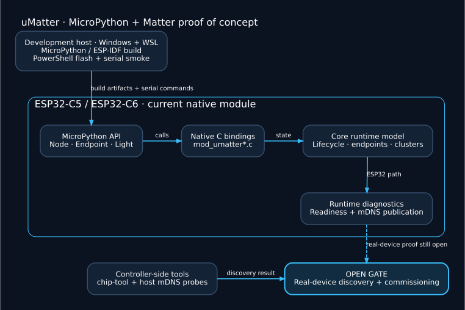

# uMatter — MicroPython and Matter PoC for ESP32-C5/C6

[](LICENSE)
[](https://github.com/mateuszsury/uMatter/actions/workflows/ci.yml)

uMatter explores **Matter device integration in MicroPython on ESP32-C5 and ESP32-C6**. It combines a native C module, a node/endpoint/cluster runtime model, commissioning diagnostics, and Windows/WSL scripts for building, flashing and smoke testing firmware.

**Status: experimental Phase 0 proof of concept.** Recorded build, flash and smoke runs are available, but the gate for **real-device discovery and Matter commissioning remains OPEN**. The reference virtual-device pairing experiment is separate evidence. See the [public roadmap](docs/ROADMAP.md) and [hardware matrix](docs/HARDWARE_MATRIX.md) for the current limits.

[Development setup](docs/DEVELOPMENT.md) · [Technical documentation](docs/README.md) · [Phase 0 validation reports](reports/phase-0/)

## Architecture Overview



The native module exposes runtime state and diagnostics to MicroPython. Host tools
build and flash the firmware, collect serial evidence, and probe controller-side
discovery. The dashed path marks the open real-device gate. Full Matter stack
integration remains planned work, as described in the architecture notes.

See the [architecture notes](docs/ARCHITECTURE.md) and the editable
[Graphviz diagram source](docs/assets/presentation/overview.dot).

## Key Goals

- Build a usable Matter runtime for MicroPython on ESP32.
- Provide a simple API (`umatter.Light(...)`) and an advanced API (`Node`, `Endpoint`, `Cluster`).
- Keep build and flashing reproducible across WSL + Windows PowerShell.
- Evolve toward release-grade CI, artifact integrity, and certification-readiness evidence.

## What Is Implemented Today

- Native user C module scaffold ([modules/umatter](modules/umatter/)).
- Core runtime model with nodes, endpoints, clusters, commissioning data, and transport state.
- Host-driven build and flash automation scripts.
- Phase-by-phase technical docs and reports with real artifacts.

See:
- [Documentation index](docs/README.md)
- [Phase 0 implementation notes](docs/phase-0/)
- [Phase 0 validation reports](reports/phase-0/)

## Repository Layout

```text
agents/                Agent contracts by domain
modules/umatter/       Native MicroPython C module (core + bindings)
scripts/               Build/flash/smoke and commissioning utilities
docs/                  Technical documentation and phase implementation notes
reports/               Validation reports and risks per step
artifacts/             Local output artifacts (ignored by git except metadata)
docs/ROADMAP.md        Public scope, milestone status and acceptance gates
mp_skill.md            Build/flash/test workflow (WSL + PowerShell)
AGENTS.md              Orchestration and agent usage policy
```

## Quick Start (Windows + WSL)

Use a supported ESP32 board and configure your local WSL tool paths with the
[development guide](docs/DEVELOPMENT.md). `COM11` below is an example: replace it
with your board's actual serial port. For checks without a board, use
[Repository Checks](#repository-checks).

1. Run environment preflight:

```powershell
powershell -ExecutionPolicy Bypass -File scripts/phase0_preflight.ps1
```

2. Build/flash/smoke for ESP32 target:

```powershell
powershell -ExecutionPolicy Bypass -File scripts/phase0_step02_c5_e2e.ps1 `
  -ComPort COM11 `
  -Board ESP32_GENERIC_C6 `
  -UserCModulesPath modules/umatter `
  -PartitionCsv scripts/partitions/partitions-4MiBplus-app2560k.csv `
  -ArtifactsRoot artifacts/esp32c6
```

3. Run commissioning runtime diagnostics smoke:

```powershell
powershell -ExecutionPolicy Bypass -File scripts/phase0_step16_commissioning_runtime_diag.ps1 `
  -ComPort COM11
```

## Supported Development Flow

- Build: WSL (ESP-IDF + MicroPython sources/worktrees)
- Flash/device ops: Windows PowerShell (`esptool`, `mpremote`)
- Concurrency-safe builds: unique `BuildInstance` and isolated worktrees/build directories

## Documentation Map

- Product scope and milestone status: [Public roadmap](docs/ROADMAP.md)
- Architecture: [Architecture overview](docs/ARCHITECTURE.md)
- Build workflow: [MicroPython firmware workflow](mp_skill.md)
- Agent execution model: [AGENTS.md](AGENTS.md), [agent contracts](agents/)
- Implementation notes by phase: [docs/phase-0/](docs/phase-0/)
- Validation reports: [reports/phase-0/](reports/phase-0/)
- Contribution process: [CONTRIBUTING.md](CONTRIBUTING.md)
- Security policy: [SECURITY.md](SECURITY.md)

## Roadmap

Milestone status and acceptance gates are tracked in the [public roadmap](docs/ROADMAP.md):

1. Phase 0: PoC
2. Phase 1: MVP
3. Phase 2: Completeness
4. Phase 3: Appliances and Energy
5. Phase 4: Advanced + 2.x release

## Repository Checks

From the repository root, run the checks that do not require a board:

```bash
python scripts/check_repository.py
bash -n scripts/wsl_idf_build.sh
bash -n scripts/wsl_build_micropython_c5.sh
```

GitHub Actions also parses PowerShell scripts on Windows. These checks validate
repository files, documentation links and script syntax; they do not establish
a successful firmware build or Matter commissioning. Device and controller
validation remains documented in [Phase 0 reports](reports/phase-0/).

## License

This project is licensed under the Apache License 2.0.
See [LICENSE](LICENSE).
